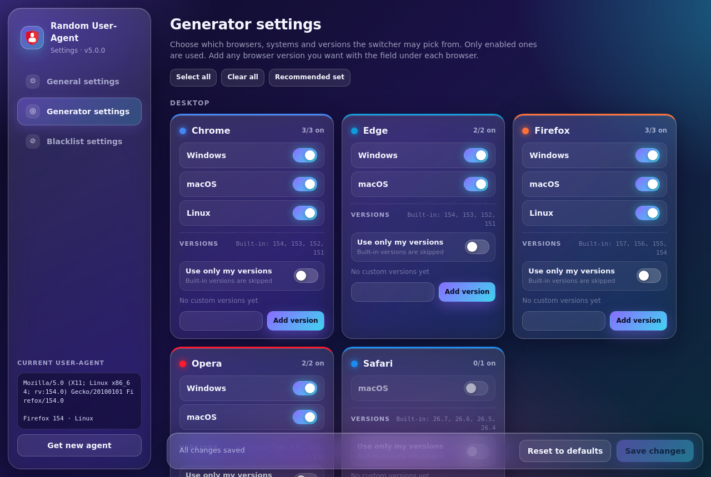
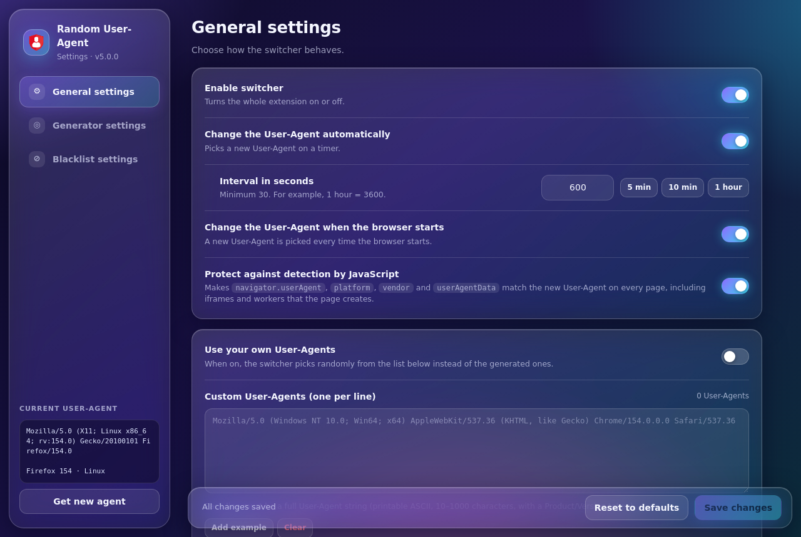
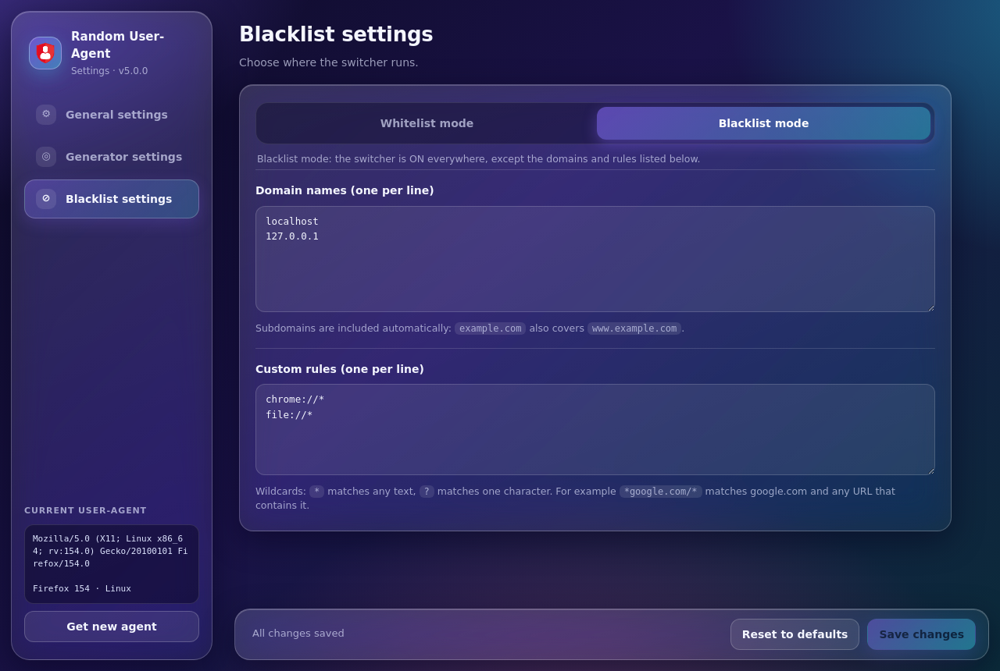

<div align="center">


# Random User-Agent

### A glassmorphism User-Agent switcher for Chromium browsers

Switch your User-Agent to real **Chrome, Edge, Firefox, Opera and Safari** devices, on a timer, on browser start, or on demand.

<p>
  
  
  
  
</p>

<p>
  <a href="#-quick-start"><b>Quick start</b></a> ·
  <a href="#-features"><b>Features</b></a> ·
  <a href="#-how-it-works"><b>How it works</b></a> ·
  <a href="#%EF%B8%8F-troubleshooting"><b>Troubleshooting</b></a> ·
  <a href="#-limitations"><b>Limitations</b></a> ·
  <a href="#-বাংলায়-সংক্ষেপে"><b>বাংলায়</b></a>
</p>

</div>

---

## 🖼️ Screenshots

<table>
  <tr>
    <td width="50%"><p align="center"><sub><b>Generator settings</b>: one glass card per browser, with OS switches and your own versions</sub></p></td>
    <td width="50%"><p align="center"><sub><b>General settings</b>: timer, startup change, JavaScript protection, blocked-site fallback, custom User-Agents</sub></p></td>
  </tr>
  <tr>
    <td width="50%"><p align="center"><sub><b>Blacklist / Whitelist</b>: choose where the switcher runs</sub></p></td>
    <td width="50%"><p><b>Popup</b>: the active User-Agent with <b>Copy</b>, a per-site toggle (<b>Enabled on this site</b>), a device grid, <b>Pause</b>, <b>Get new agent</b>, and a <b>User-Agent test</b> button that opens whatismybrowser.com in a new tab.</p></td>
  </tr>
</table>

---

## ✨ Features

| | Feature | What it does |
|:-:|---|---|
| 🎯 | **Popup** | Active User-Agent with **Copy**, a per-site toggle, device grid, **Pause**, **Get new agent**, and **Open settings**. A warning appears if the page still shows your real browser |
| 🔍 | **User-Agent test** | One click opens [whatismybrowser.com](https://www.whatismybrowser.com/detect/what-is-my-user-agent/) in a new tab. The extension is ON there by default, so you see the new User-Agent immediately |
| 🧬 | **Real device identities** | Built-in Chrome, Edge, Firefox, Opera and Safari User-Agents for Windows, macOS, Linux, Android and iPhone |
| 🔢 | **Your own versions** | Add a version under any browser card (for example Chrome `200`). Built-in versions are included by default |
| 🎚️ | **"Use only my versions"** | Per-browser switch. When on, only your versions are used for that browser |
| ⏱️ | **Auto-change timer** | Renews every N seconds (default 600 s, minimum 30 s) |
| 🚀 | **Change on start** | Picks a new identity each time the browser starts |
| ⌨️ | **Keyboard shortcut** | `Ctrl+Shift+U` (`Cmd+Shift+U` on macOS) renews the User-Agent |
| 🛡️ | **JavaScript protection** | Makes `navigator` values (`userAgent`, `userAgentData`, `platform`, `vendor`, `maxTouchPoints`) match the chosen identity |
| 🚫 | **Blacklist / Whitelist** | Blacklist mode (everywhere except listed sites) or whitelist mode (only listed sites). Supports subdomains and wildcard URL rules |
| 📝 | **Custom User-Agents** | Add your own strings, one per line. Must be printable ASCII, 10–1000 characters, with a `Product/Version` token |
| 🛟 | **Blocked-site fallback** | **On by default.** If a site answers `403` or `429` to a spoofed User-Agent (for example Akamai bot protection), the extension reloads that page once with your real User-Agent for the browser session. The popup then shows **REAL UA** and a **Try spoofing again** button. Turn the switch off in General settings to always show your chosen User-Agent |
| 🔋 | **Service-worker keepalive** | A lightweight content script keeps the extension's background worker running while web pages are open, so the rules and timers stay responsive |
| 🪟 | **Glassmorphism UI** | Glass cards, gradients and soft glow across the popup and settings page |

### Generator settings

Each browser has its own card. Turn OS targets on or off, and add versions:

| Browser | Version you can add | Example |
|---|---|---|
| Chrome, Edge, Firefox | 50–999 | `200` |
| Opera | Opera's own number (Chromium − 16) | `130` |
| Safari | 10–40, as `x` or `x.y` | `26.8` |

---

## 🚀 Quick start

1. Download the zip, or clone this repository, and **unzip it to a normal folder** (not OneDrive).
2. Open `chrome://extensions` (or `edge://extensions`, `opera://extensions`).
3. Turn on **Developer mode**.
4. Click **Load unpacked** and select the folder that contains `manifest.json`.
5. Open the popup, click **User-Agent test**, and check the User-Agent on whatismybrowser.com.

Requires **Chromium 120+**.

---

## ⚙️ How it works

```
 Browser request ──► declarativeNetRequest ──► User-Agent + Sec-CH-UA* rewritten
                                               (per identity, per site rules)
 Page script     ──► content/inject.js (MAIN world) ──► navigator.* matches identity
 Keepalive       ──► content/keepalive.js (isolated)  ──► keeps background.js awake
 Timer / start / ──► background.js (service worker)  ──► picks a new identity
 shortcut            └─ blocked 403/429 ──► one reload with the real UA (opt-in fallback)
```

- **Headers:** `User-Agent` and `Sec-CH-UA*` headers are rewritten with `declarativeNetRequest` dynamic rules. Client Hints that would reveal the real browser (full version, platform version, architecture, model) are removed.
- **JavaScript:** Chromium-family identities also get a matching `navigator.userAgentData`. Firefox and Safari identities remove it, as those browsers do.
- **Frames:** header and `navigator` changes also apply to iframes and `about:blank` frames.
- **Fallback:** a `403` or `429` response to a spoofed request on a site you have enabled triggers one reload with the real User-Agent for that host. The bypass lasts for the browser session and is cleared on restart or with **Try spoofing again**.
- **Keepalive:** Chrome normally stops an idle MV3 service worker after about 30 seconds. `content/keepalive.js` opens a port to the worker and sends a small heartbeat while a page is open. A 30-second alarm acts as a backup when no page is open. Nothing else in the script runs.
- **Storage:** all settings live in `chrome.storage.local`. Nothing is sent to a server.

> [!TIP]
> **"Access Denied" on a site.** Some sites (for example Akamai-protected stores) block requests whose User-Agent does not match the browser's real network fingerprint. With the default fallback ON, these sites are reloaded once with your real User-Agent. If you turned the fallback off and see "Access Denied", turn it back on in General settings. For a site you want always on your real browser, turn its switch OFF in the popup. To restore spoofing everywhere, use **Blacklist settings → Turn ON for all sites**.

---

## 🛠️ Troubleshooting

**The site still shows my real browser (for example Chrome on Windows).**

1. **Site access:** `chrome://extensions` → Random User-Agent → **Details** → **Site access** must be **On all sites**.
2. **Other extensions:** security and privacy extensions can override the page's `navigator` and headers. Vytal, for example, did this. Turn off the others, reload the page with `Ctrl+F5`, then check `navigator.userAgent` in the page's console (choose the `top` context, not `background.js`).
3. **Errors:** the card in `chrome://extensions` shows an **Errors** button if something failed to load. Install from one unzipped folder with `manifest.json` at its top level. Avoid OneDrive-synced folders.
4. **Old copies:** remove every old copy of the extension before loading the new one, then restart Chrome.

**The service worker shows "Inactive" in `chrome://extensions`.**
This is normal. Chrome stops idle service workers. The keepalive keeps it running while a web page is open, and the rules are stored in Chrome itself, so spoofing keeps working even when the worker is asleep.

Errors from other sites (CORS blocks, CSP `eval` warnings, `content.js` errors that are not from this extension) come from the website or other extensions. They are not caused by Random User-Agent.

---

## ⚠️ Limitations

Please read these before you rely on the extension:

- **No guarantee on every website.** Some sites block by IP address or by fingerprint, not only by User-Agent. The fallback can't fix those.
- **Deep fingerprinting still sees the engine.** Rendering, JavaScript engine and font behaviour reveal the real browser. Chromium can't become identical to Firefox or Safari.
- **Web Workers report the real User-Agent.** Extension content scripts don't run inside workers, so `navigator.userAgent` in a worker is still the real one.
- **Service-worker keepalive is best-effort.** Chrome can still stop the worker on restart, on extension update, or under memory pressure.
- **Other security extensions can conflict.** Turn off extensions that rewrite `navigator` or headers for the sites you test.

---

## 🗂️ Project layout

```
manifest.json, background.js     service worker: state, rules, alarm, messages, keepalive port
lib/devices.js                   built-in real device UAs, version pools, custom UA parsing
lib/profile.js                   navigator / userAgentData profile per identity
lib/rules.js                     declarativeNetRequest rule builder
lib/matching.js                  domain and wildcard matching
lib/generator.js                 random pick from enabled types and versions
lib/settings.js                  defaults, normalisation, validation
content/inject.js                MAIN-world navigator patch
content/keepalive.js             isolated-world port that keeps the service worker awake
popup/  options/  shared/        UI (glass theme in shared/ui.css)
assets/icons/                    toolbar icons (on / gray)
docs/screenshots/                images used in this README
tests/unit.mjs                   unit tests
tests/e2e/                       end-to-end tests (Playwright + Chromium)
```

---

## 🧪 Tests

**Unit tests** (no dependencies):

```bash
node tests/unit.mjs
```

**End-to-end tests** (Playwright + Chromium):

```bash
npm i playwright
npx playwright install chromium
node tests/e2e/server.mjs          # serves 127.0.0.1:8080
node tests/e2e/e2e.mjs             # headless
HEADFUL=1 DISPLAY=:99 node tests/e2e/e2e.mjs   # headful, also checks Ctrl+Shift+U
```

The e2e test maps `*.test` hosts to `127.0.0.1:8080` with `--host-resolver-rules`.

---

## 🔐 Permissions

| Permission | Why |
|---|---|
| `declarativeNetRequest` | Rewrite request headers (User-Agent, Client Hints) |
| `webRequest` | Detect blocked responses (403/429) for the optional fallback |
| `scripting` | Check whether the User-Agent really applied on the current page (popup warning) |
| `storage` | Save your settings locally |
| `alarms` | Run the auto-change timer and the keepalive backup |
| `<all_urls>` (host) | Apply the User-Agent on every site |

---

<details>
<summary><h2>🇧🇩 বাংলায় সংক্ষেপে</h2></summary>

**Random User-Agent** একটি Chromium এক্সটেনশন। এটি আপনার ব্রাউজারের User-Agent বাস্তব Chrome, Edge, Firefox, Opera ও Safari ডিভাইসের মতো করে বদলায়।

- **User-Agent test** বাটনে ক্লিক করলে whatismybrowser.com নতুন ট্যাবে খোলে। সেখানে এক্সটেনশন ডিফল্টভাবে ON থাকে, তাই আপনি সরাসরি বদলানো User-Agent দেখতে পারবেন।
- **Generator settings**-এ প্রতিটি ব্রাউজারের কার্ডে নিজের ভার্সন যোগ করা যায়, যেমন Chrome-এর জন্য `200`।
- **"Use only my versions"** চালু করলে ওই ব্রাউজারের জন্য শুধু আপনার যোগ করা ভার্সন ব্যবহৃত হয়।
- `Ctrl+Shift+U` দিলে নতুন User-Agent নেওয়া হয়।
- **Use my real browser on blocked sites** ডিফল্টভাবে ON থাকে। কোনো সাইট spoof করা User-Agent ব্লক করলে সেটি একবার আসল User-Agent নিয়ে খোলা হয়। এটি বন্ধ করলে সবসময় সেট করা User-Agent দেখানো হবে।
- Service worker-এর জন্য একটি keepalive আছে, যাতে ওয়েব পেজ খোলা থাকলে extension সক্রিয় থাকে।
- সব সেটিংস শুধু আপনার ব্রাউজারে (`chrome.storage.local`) থাকে, কোথাও পাঠানো হয় না।

**সীমাবদ্ধতা:** কিছু সাইট IP ঠিকানা বা fingerprint দিয়েও ব্লক করে, তাই সব সাইটে Access Denied না আসা নিশ্চিত করা যায় না। গভীর fingerprinting-এ Chromium-কে Firefox বা Safari-র মতো হুবহু দেখানো সম্ভব নয়। Web Worker-এর `navigator.userAgent` এখনো আসল UA দেখায়।

</details>

---

<div align="center">

Made with ❤️ Engr.Akash Debnath · Plain JavaScript and CSS, no build step

</div>
